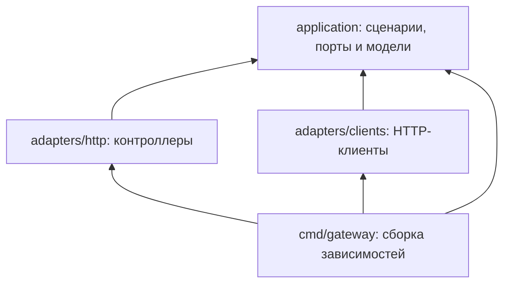
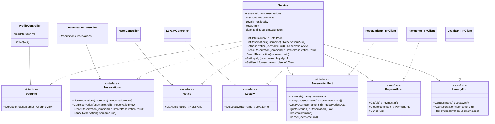
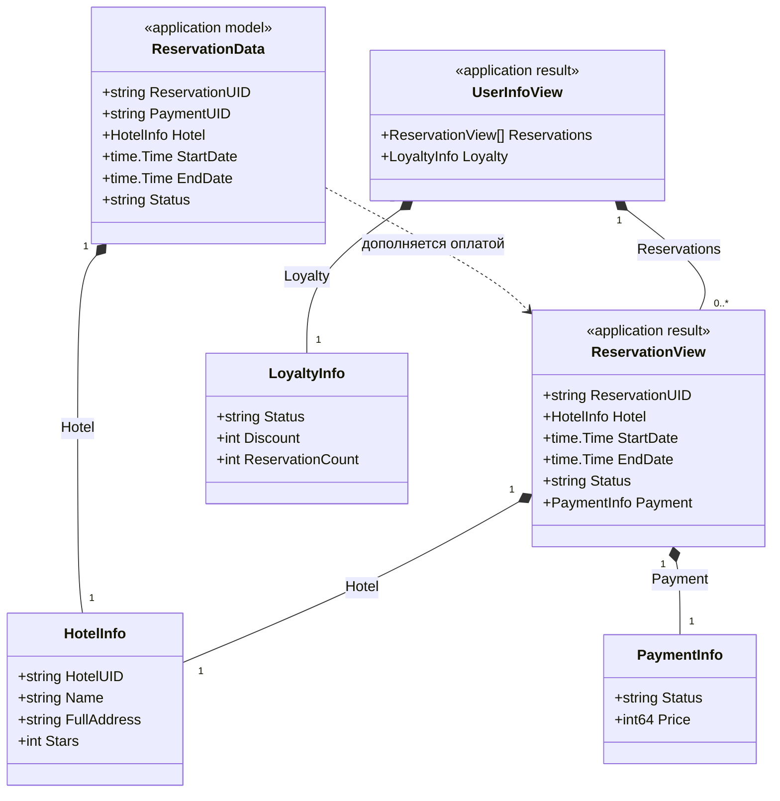

# Проектирование Gateway

Статус: Gateway и три зависимых сервиса реализованы. Сценарии Gateway
объединены в один `application.Service` с семью именованными методами.
Публичный контракт находится в `v2/[inst][v2] Hotels Booking System.yml`.
Внутренние маршруты и гарантии: `docs/gateway-internal-api.md`.
Запуск и проверки: `docs/gateway.md`.

## Слои и направление зависимостей

Идея: контроллер принимает запрос и вызывает сценарий через интерфейс. Сценарий
координирует работу через интерфейсы внешних зависимостей, которые реализуются
HTTP-клиентами. Прямых сетевых вызовов в сценариях нет.

Бизнес-слой разделяется на прикладные сценарии (`application`) и предметные
правила (`domain`). Получение данных из нескольких сервисов и порядок вызовов
относятся к `application`. Правила уровней лояльности и бронирования принадлежат
доменам соответствующих сервисов. У Gateway сейчас нет отдельной предметной
модели, требующей собственного пакета `domain`.

| Часть | Ответственность | Разрешенные зависимости |
|---|---|---|
| `adapters/http` | Контроллеры, интерфейсы вызываемых сценариев, публичные DTO, HTTP-статусы, разбор и форматирование данных | Прикладные модели из `application`, стандартная библиотека, библиотека UUID на границе |
| `application` | Сценарии, порты, команды, результаты, ошибки приложения | Собственные типы и стандартная библиотека; собственный `domain`, если появится |
| `adapters/clients` | HTTP-взаимодействие с сервисами, внутренние транспортные DTO, преобразование ошибок | `application`, стандартная библиотека |
| `cmd/gateway` | Конфигурация, создание клиентов и сценариев, внедрение зависимостей, запуск | Конкретные реализации всех необходимых частей |

Интерфейсы внешних зависимостей принадлежат `application`, который их потребляет.
Реализации находятся в `adapters/clients`. Интерфейсы сценариев принадлежат
контроллерам-потребителям и определяются в `adapters/http`. Их сигнатуры используют
прикладные команды и результаты, без HTTP-типов. Контроллер зависит от такого
интерфейса и прикладных моделей, а не от конкретной структуры сценария.

В Go соответствие интерфейсу неявное: `Service` реализует HTTP-интерфейс
`UserInfo` своим методом `GetUserInfo`, не импортируя HTTP-адаптер. Прикладной слой также
не импортирует слой межсервисных HTTP-клиентов. Подстановка всех реализаций
происходит в `main.go` через конструкторы.



Стрелки на этой схеме показывают зависимости исходного кода. При выполнении
сценарий вызывает порт, а фактический HTTP-клиент выполняет сетевой запрос.

## Контроллеры и сценарии

Каждый контроллер — структура с HTTP-методами, возвращающими `error`.
Маршрутизатор адаптирует их в `http.HandlerFunc`, централизованно журналирует
ошибки и формирует HTTP-ответы. Это убирает одинаковую обработку ошибок
из каждого метода контроллера.
Прикладные сценарии — методы одной структуры `application.Service`.
Она хранит три внешних порта, генератор UUID и таймаут компенсаций. Все данные
конкретного запроса остаются в локальных переменных методов; одна структура
используется всеми контроллерами и параллельными запросами.

Контроллер получает один небольшой интерфейс со всеми нужными ему операциями:
`Hotels`, `Reservations`, `Loyalty` или `UserInfo`. Интерфейс `Reservations`
содержит четыре именованных метода чтения, создания и отмены бронирований.
Дополнительные интерфейсы для самих контроллеров не требуются: маршрутизатор
адаптирует их HTTP-методы в обработчики.

| Контроллер | Метод и маршрут | Метод Service |
|---|---|---|
| `HotelController` | `GET /api/v1/hotels` | `ListHotels` |
| `ReservationController` | `GET /api/v1/reservations` | `ListReservations` |
| `ReservationController` | `GET /api/v1/reservations/{reservationUid}` | `GetReservation` |
| `ReservationController` | `POST /api/v1/reservations` | `CreateReservation` |
| `ReservationController` | `DELETE /api/v1/reservations/{reservationUid}` | `CancelReservation` |
| `LoyaltyController` | `GET /api/v1/loyalty` | `GetLoyalty` |
| `ProfileController` | `GET /api/v1/me` | `GetUserInfo` |

`GET /manage/health` обслуживается отдельным простым HTTP-обработчиком.

Контроллер проверяет наличие обязательного заголовка, синтаксис UUID, JSON и дат,
формирует аргументы сценария и преобразует результат или ошибку в HTTP-ответ.
Заголовок `X-User-Name` — идентификатор пользователя по условию лабораторной;
сам по себе он не является аутентификацией.

Сценарии не принимают `http.Request` и `http.ResponseWriter`, не возвращают
HTTP-статусы, не читают URL сервисов и не сериализуют JSON.

## Диаграмма классов: контроллеры, прикладной сервис и порты

На диаграмме опущены ошибки и `context.Context` в сигнатурах. `Service`
реализует четыре потребительских интерфейса HTTP-слоя и использует три порта
внешних сервисов. Интерфейс не требуется каждому отдельному методу.



Порты принадлежат `application`: они описывают все операции, которые `Service`
использует у соответствующего внешнего сервиса. HTTP-контроллеры видят только
свои небольшие интерфейсы, а конкретные HTTP-клиенты известны точке сборки.

Например, интерфейс профиля и его контроллер определены в HTTP-адаптере:

```go
type UserInfo interface {
    GetUserInfo(ctx context.Context, username string) (application.UserInfoView, error)
}

type ProfileController struct {
    userInfo UserInfo
}

func NewProfileController(userInfo UserInfo) *ProfileController {
    return &ProfileController{userInfo: userInfo}
}
```

В тестах `Service` подставляются реализации трех внешних портов. В тестах
контроллеров подставляются реализации соответствующих HTTP-интерфейсов.
Отдельные структуры сценариев и методы с общим названием `Execute` не нужны.
Реализация семи методов распределена по файлам по назначению.

## Внедрение зависимостей — DI

Используется ручное внедрение через конструкторы. Объект получает уже созданные
зависимости и сохраняет их в полях. Он не создает их внутри методов и не ищет
через глобальные переменные или service locator.

Интерфейс задает контракт, DI определяет способ передачи реализации.
Сборка в `cmd/gateway/main.go` после создания трех HTTP-клиентов:

```go
service := application.NewService(
    reservationClient,
    paymentClient,
    loyaltyClient,
    newID,
    cfg.CleanupTimeout,
)

hotels := httpadapter.NewHotelController(service)
reservations := httpadapter.NewReservationController(service)
loyalty := httpadapter.NewLoyaltyController(service)
profile := httpadapter.NewProfileController(service)

handler := httpadapter.NewRouter(
    hotels, reservations, loyalty, profile,
    cfg.RequestTimeout, logger,
)
```

`newID` — переданная функция генерации UUID. Тесты могут подставить детерминированный
генератор. `httpadapter` — псевдоним импорта `internal/gateway/adapters/http`.
Совместимость `*application.Service` с каждым интерфейсом контроллера проверяется
компилятором при передаче в конструктор. Зависимости исходного кода направлены
внутрь, несмотря на вызовы конкретных адаптеров во время выполнения.

## Структуры данных прикладного слоя

Это собственные модели Gateway в `application`, без JSON-тегов и типов драйверов.
Они не импортируются из исходного кода других сервисов и не являются их
доменными сущностями.



`ReservationData` содержит ссылку `PaymentUID`, по которой сценарий получает
оплату. В публичном результате `ReservationView` вместо этой ссылки находится
информация об оплате. Проверка владельца выполняется в Reservation по переданному
пользователю до возврата данных; сценарий не получает чужую бронь для последующей
фильтрации.

В прикладных моделях даты представлены нормализованными календарными датами
через `time.Time` в UTC. HTTP-адаптеры разбирают и форматируют `YYYY-MM-DD`.
`Price` соответствует целочисленной модели суммы в SQL задания; единицы и
округление должны быть одинаково зафиксированы в контрактах Reservation и Payment.

## Публичные и внутренние DTO

Публичный `UserInfoResponse` и вложенные `ReservationResponse`,
`HotelInfoResponse`, `PaymentInfoResponse`, `LoyaltyInfoResponse` находятся
в `adapters/http`. Их поля и JSON-теги соответствуют публичному OpenAPI.

Например, `UserInfoResponse` содержит `reservations` и `loyalty`,
`ReservationResponse` — `reservationUid`, `hotel`, `startDate`, `endDate`, `status`,
`payment`. Массив бронирований сериализуется как `[]`, когда элементов нет.

В `adapters/clients` находятся отдельные DTO внутренних HTTP-контрактов.
Например, `reservationResponseDTO` преобразуется клиентом в `ReservationData`.
Поля и маршруты этих контрактов определены в `docs/gateway-internal-api.md`.

```text
JSON Reservation Service
    -> reservationResponseDTO          adapters/clients
    -> ReservationData                application
    -> ReservationView                application, после получения оплаты
    -> ReservationResponse            adapters/http
    -> публичный JSON
```

Сходство полей допустимо: транспортные контракты и прикладные результаты имеют
разные причины изменения. Преобразования выполняются простыми функциями;
дополнительные классы-мапперы для каждого типа не нужны.

## Последовательность GET /api/v1/me

1. `ProfileController.GetMe` читает и проверяет обязательный `X-User-Name`.
2. Вызывает `GetUserInfo(ctx, username)` через HTTP-интерфейс `UserInfo`.
   В рабочей сборке это метод `application.Service`.
3. Сценарий получает `[]ReservationData` через `ReservationPort.ListByUser`.
4. Для бронирований получает оплаты через `PaymentPort.Get`, используя
   `PaymentUID`. Для начальной реализации достаточно последовательных вызовов
   с общим контекстом и ограниченными таймаутами; пакетное чтение можно добавить
   в отдельный порт при необходимости.
5. Через `LoyaltyPort.Get` получает лояльность пользователя.
6. Собирает `UserInfoView`, включая пустой список при отсутствии бронирований.
7. Контроллер преобразует результат в `UserInfoResponse` и возвращает `200`.

Ошибки клиентов преобразуются в ошибки приложения, например `ErrNotFound`
или `DependencyError`. В них нет `http.Response` и кодов downstream API.
Публичный HTTP-статус выбирает контроллер. При недоступности некритичных
Payment/Loyalty сценарий отмечает отсутствующую часть ответа специальным флагом,
а контроллер сериализует ее как `{}`. Отказ основного Reservation дает ошибку.
Circuit Breaker находится в HTTP-транспорте клиентов; порт очереди компенсаций
принадлежит приложению, реализация очереди RabbitMQ — `adapters/retryqueue`. Порт `Enqueue` принимает
`context.Context`, а AMQP-соединение создается в `cmd/gateway`.

## Структуры и порты сценариев изменения состояния

Для создания нужны `CreateReservationRequest` в HTTP-адаптере и
`CreateReservationCommand` в приложении:

```go
type CreateReservationCommand struct {
    Username  string
    HotelUID  string
    StartDate time.Time
    EndDate   time.Time
}
```

Результат `CreateReservationResult` содержит `ReservationUID`, `HotelUID`,
`StartDate`, `EndDate`, `Discount`, `Status`, `Payment PaymentInfo`.
Контроллер преобразует его в публичный `CreateReservationResponse`.

Метод `Service.CreateReservation` использует `ReservationPort`,
`PaymentPort`, `LoyaltyPort`: расчет и сохранение брони, создание
и компенсация оплаты, чтение скидки и изменение учета бронирования.
Эти порты реализуют те же три HTTP-клиента.

`Service.CreateReservation` генерирует UUID брони и оплаты до изменяющих запросов.
Каждая компенсация регистрируется до соответствующей записи: потерянный ответ
не доказывает отсутствие изменения. При ошибке выполняются обратные операции
с отдельным контекстом и общим ограниченным временем компенсации.

`Service.CancelReservation` получает пользователя и UUID, проверяет принадлежность через
`ReservationPort.GetByUser` и координирует отмену оплаты, учета лояльности и брони. Команды,
идемпотентность по UUID и запрет оживления отмененных операций описаны
в `docs/gateway-internal-api.md`. Из локального флага `status = CANCELED`
нельзя делать вывод, что остальные межсервисные шаги уже завершились.

## Структура файлов

```text
cmd/gateway/main.go
internal/gateway/
  application/
    ports.go
    models.go
    errors.go
    service.go
    hotels.go
    reservation_queries.go
    user_info.go
    create_reservation.go
    cancel_reservation.go
  adapters/
    http/
      routes.go
      controllers.go
      handlers.go
      dto.go
    clients/
      reservation_client.go
      payment_client.go
      loyalty_client.go
      transport.go
      dto.go
  config/
    config.go
```

В начале DTO каждого клиента можно хранить рядом с его реализацией. Общий
технический HTTP-код выделяется только при появлении повторения. Прямого доступа
Gateway к PostgreSQL в этой модели нет.
